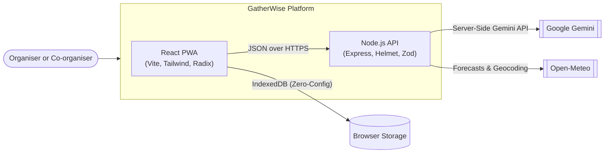
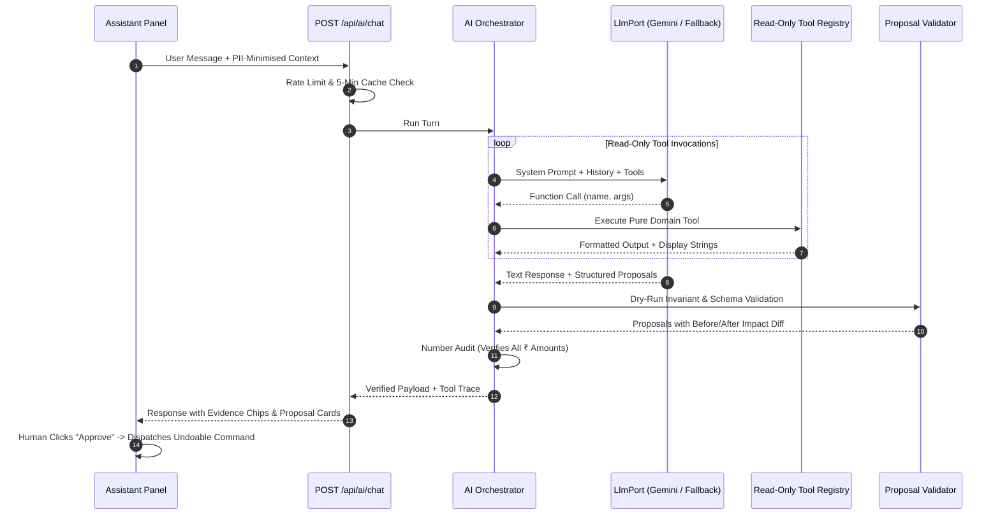

<div align="center">

# 💜 GatherWise

### Plan beautifully. Spend wisely. Celebrate confidently.

**An execution-first planning workspace for Indian celebrations** — weddings, birthdays, and community events — with budgets that add up, timelines that adapt, vendor checklists and quote comparison, and an AI copilot that *proposes* changes you approve.


[Overview](#-overview) · [Features](#-features) · [Architecture](#-architecture) · [Demo journeys](#-the-demo-path) · [Quick start](#-quick-start) · [Testing](#-testing)

</div>

---

## 🌸 Overview

GatherWise is an execution-first planning workspace for Indian celebrations. It supports three core planning contexts:

| 💍 Weddings | 🎂 Milestone birthdays | 🎪 Community festivals |
|---|---|---|
| Multi-day functions such as Sangeet, Ceremony, and Reception | Parents organising milestone birthdays | Volunteer committees coordinating neighbourhood events |

### 🎯 The problem

Planning celebrations in India is notoriously stressful and financially opaque. Families juggle multiple functions with shifting guest counts, vendor quotes that exclude 18% GST or hide overtime fees, and fragmented WhatsApp threads. Most planning apps are either glorified note-taking checklists or generic chatbots that hallucinate costs and cannot do arithmetic.

Organisers face:

- 💸 **Budget surprises:** Unclear tax-exclusive quotes and double-counted advance deposits turn a ₹10 Lakh budget into a ₹13 Lakh reality.
- ⏱️ **Timeline compression:** Traditional wedding timelines assume 6–12 months; real users often have 8 weeks, leading to missed vendor booking windows.
- 👥 **Headcount volatility:** Different functions (e.g., intimate Mehendi vs. large Reception) require distinct headcount assumptions, creating catering waste or food shortages.
- 🤖 **Unverified AI advice:** Generic LLMs invent vendor rates and make unsubstantiated claims without mathematical guarantees.

---

## 🧭 Approach and logic

GatherWise is built on three strict architectural rules visible directly in the code:

### 1. 🧮 The app calculates

Money is strictly stored and calculated as integer paise (`Minor`). Budgets, MCDA quote comparisons, critical-path schedules, attendance estimations, and readiness scores are pure functions in `shared/domain` with exhaustive unit and property-based tests. Zero arithmetic is delegated to an LLM.

### 2. 🤝 The AI proposes

Google Gemini reads the plan through read-only tools querying a PII-minimised snapshot. The AI never mutates state directly. Instead, it returns structured *proposals* (e.g., adding a task, reallocating budget). Every proposal is dry-run, checked against domain invariants, rendered with an exact before/after impact diff, and requires explicit human approval before being applied as an undoable command.

### 3. 🔎 Everything is explained

Every task, risk flag, and readiness score reveals the exact mathematical inputs and rules that generated it; heuristics cite documented Indian industry benchmarks (`docs/BENCHMARKS.md`).

### Core algorithms

| Algorithm | What it guarantees or does |
|---|---|
| 🧾 **The Budget Identity** | Guaranteed `projected = committed + max(0, estimate - committed)` with zero double-counting of advances. |
| 🧮 **GST-Aware Quote Normalisation** | Apples-to-apples MCDA comparison between per-person caterers and lump-sum packages, accounting for 18% GST and hidden fees at the target headcount. |
| 📅 **Lead-Time Compression** | Automatically flags infeasible dependencies for compressed timelines and reflows tasks around user-locked dates. |
| 🌺 **Five-Petal Readiness Bloom** | Holistic, explainable readiness vector across Tasks, Budget, Vendors, Guests, and Schedule. |

---

## 🏗️ Architecture

### System context



### AI copilot & proposal loop



---

## ✨ Features

| Area | Implemented | Notes |
|---|:---:|---|
| 🪄 **Creation Wizard** | ✓ | 6-step guided wizard with multi-function support, Indian currency parser ("5 lakh"), and plan preview |
| 📊 **Dashboard** | ✓ | Command centre with five-petal Readiness Bloom SVG, budget bar, upcoming deadlines, and weather widget |
| 🗓️ **Tasks & Timeline** | ✓ | List, Kanban Board, and Month Calendar views; lead-time scheduling, dependency guards, and RFC 5545 `.ics` export |
| 💰 **Budget & Payments** | ✓ | 3-point estimates (low/likely/high), payment log (UPI, cash, bank, card, cheque), overdue payment alerts, and CSV export |
| 🤝 **Vendor Management** | ✓ | Pipeline tracking, enquiry checklists, contract review reminders, and one-tap `tel:` and WhatsApp links |
| ⚖️ **Quote Comparison** | ✓ | Multi-criteria decision analysis (MCDA) with editable criteria weights, tax normalisation, and 1-click commitment creation |
| 📄 **Quote Scanner** | ✓ | Quotation document upload (PDF/PNG/JPEG), OCR item extraction, subtotal math verification, and GST normalisation |
| 👥 **Guest Management** | ✓ | Household units, multi-function RSVP tracking, search & filtering, CSV import/export with formula injection defense |
| 🍽️ **Headcount & Catering** | ✓ | High/likely/low attendance planner, children plate equivalents, and print-ready Catering Brief with dietary breakdown |
| 🪑 **Seating Helper** | ✓ | Table capacity tracking, dietary preference displays, and instant guest seating allocation (GUE-09) |
| 💌 **Invite Studio** | ✓ | Multilingual invitation copy generator (English, Hindi, Marathi, etc.) with personalized WhatsApp dispatch links |
| 🎬 **Run-of-Show & Day-of** | ✓ | Minute-by-minute timeline coordination, buffer absorption, delay cascade, fixed-time conflict checks, and mobile Now/Next mode (EXE-01, EXE-02) |
| 🧑‍🤝‍🧑 **Volunteer Roster** | ✓ | Shift scheduling, community station assignment, coverage gap warnings, and direct contact dispatch (EXE-03) |
| 🎗️ **Funding & Sponsors** | ✓ | Multi-tier sponsorship pipeline, weighted expected funding, deliverables tracking, and concentration risk alerts (FND-01) |
| 🌐 **Hindi UI (i18n)** | ✓ | Comprehensive English and Hindi translation dictionary with seamless in-app language switching (SYS-06) |
| ☁️ **Cloud Mode Adapter** | ✓ | Implemented `FirestoreRepository` adapter & security rules in `firebase/firestore.rules` (marked unexercised without live cloud credentials) (SYS-05) |
| 🤖 **AI Copilot** | ✓ | PII-minimised context, read-only tools, number audit, proposal cards with diffs, and 50-step atomic undo |
| 📴 **Rule-Based Fallback** | ✓ | Fully operational offline assistant matching intents to domain tools when no Gemini API key is present |
| 💡 **Idea Studio** | ✓ | Curated celebration inspiration library with cultural context and 1-click "Pin to Task" |
| 🧪 **What-if Lab** | ✓ | Interactive headcount and budget line sliders, target breach detection, priority conflict alerts, and scenario saving |
| 📉 **Commitment Drift** | ✓ | Real-time warnings when committed cost-per-guest diverges by >5% from initial budget assumptions |
| 🌦️ **Weather Watch** | ✓ | 16-day Open-Meteo forecast, Indian city coordinates, 3-hour cache, seasonal rain/heat/wind risk detection |
| ⏳ **Time Travel & Demo** | ✓ | 3 pre-seeded celebration scenarios with dynamic T-60 to T-0 date scrubber for live demonstrations |
| 📦 **Data Portability** | ✓ | Full JSON workspace export, CSV downloads, printable PDF views, and 1-click workspace reset |

### 🛣️ Roadmap (Post-Full Tier Extensions)

- 🔗 **Public Guest RSVP Portal:** Dedicated public web link for self-serve guest RSVPs via secure HMAC tokens.
- 📱 **Native Mobile Apps:** React Native or Flutter companion apps.

---

## 🎥 The Demo Path (Tested Journeys J1–J9)

| Journey | Demo |
|---|---|
| **J1 — First Plan in Minutes** | Complete the 6-step wizard for a 3-day Hindu wedding; instantly review the generated budget, timeline, and risk register derived from the wedding rule pack. |
| **J2 — Money Truth** | Inspect the stacked budget bar; log a ₹50,000 cash advance to a decorator and witness zero double-counting. |
| **J3 — Compare Caterers** | Evaluate Vendor A (₹1,400/plate + 18% GST) vs. Vendor B (₹1,550/plate all-inclusive) at 300 guests; see Vendor A normalised to ₹4,95,600 and Vendor B to ₹4,65,000 (true difference ₹30,600). |
| **J4 — Plans Change** | Open Copilot; ask to trim ₹50,000 from decor; inspect the generated proposal card with exact before/after deltas; approve with 1 click; revert via atomic Undo. |
| **J5 — RSVP to Caterer** | Run the Headcount Planner; calculate guaranteed vs. expected turnout buffer; print the formatted Catering Brief with dietary breakdown. |
| **J6 — Time Pressure** | Use the Time Travel scrubber to jump from T-60 to T-7 days; watch the Readiness Bloom update and overdue tasks highlight. |
| **J7 — Rain on the Parade** | Review an outdoor setting warning; receive a 70% precipitation alert via Weather Watch; adopt the Copilot's proposed weatherproof marquee task and contingency reserve. |
| **J8 — Day-of Execution Mode** | Launch Day-of Mode on mobile; view the live Now/Next activity cards; trigger a 20-minute delay and witness automatic buffer absorption and fixed-time Muhurat breach detection. |
| **J9 — Funding & Sponsor Tracker** | Track festival and community sponsors; calculate confirmed vs. expected pipeline funding; view deliverables checklists and concentration risk alerts. |

---

## 🧰 Tech stack and structure

### Tech stack

| Layer | Technology |
|---|---|
| **Language** | TypeScript 5.8 (Strict mode everywhere, no `any`, no non-null assertions outside tests) |
| **Frontend** | React 18, Vite, Tailwind CSS, Radix UI Primitives, Zustand (optimistic updates, 50-command undo stack) |
| **Backend** | Node.js 22, Express, Helmet (strict CSP), Express Rate Limit, Zod validation |
| **AI Integration** | Google Gemini (`@google/genai` on server only) with pure rule-based fallback |
| **Storage** | IndexedDB via `idb` (default offline repository) |
| **Testing** | Vitest, Testing Library, `fast-check` (property-based tests) |

### Directory structure

```text
gatherwise/
├── shared/
│   ├── domain/             # Pure calculation kernel (money, budget, quotes, schedule, etc.)
│   ├── schemas/            # Zod schemas for all entities, commands, and API payloads
│   ├── commands/           # Reversible command definitions, reducers, and undo logic
│   └── planning/           # Planning engine, celebration packs (wedding, birthday, community)
├── server/
│   ├── ai/                 # Orchestrator, Gemini adapter, fallback assistant, tools, validator
│   ├── integrations/       # Open-Meteo weather integration with caching
│   ├── middleware/         # Security headers, rate limiting, request validation, error handler
│   └── routes/             # Health check, AI chat/ideas, Weather API endpoints
├── src/
│   ├── components/         # Radix UI primitives, design system components, AppShell
│   ├── features/           # Dashboard, Budget, Tasks, Vendors, Guests, WhatIf, Copilot, etc.
│   ├── storage/            # IndexedDB repository implementation
│   ├── store/              # Zustand workspaceStore and uiStore
│   └── demo/               # Seeded scenarios and Time Travel scrubber
├── public/                 # PWA manifest and web icons
└── tests/                  # Integration, architecture, and security test suites
```

### Dependency rules

- `shared/domain` is strictly pure (no DOM, no Node, no React, no side-effects).
- `src` never imports `server`; `server` never imports `src`.
- Enforced by Vitest architecture fitness tests.

---

## 🚀 Quick start (no keys needed)

GatherWise boots with **zero configuration**. Local storage, the rule-based assistant, and all planning tools work immediately without requiring API keys.

```bash
# 1. Install dependencies
npm install

# 2. Start development servers (Frontend on :3000, API on :3001)
npm run dev

# 3. Open browser
# http://localhost:3000
```

### Optional: Enable Live Google Gemini

To connect live Google Gemini models:

1. Copy `.env.example` to `.env`:

   ```bash
   cp .env.example .env
   ```

2. Add your Gemini API key:

   ```env
   GEMINI_API_KEY=your_google_gemini_api_key_here
   GEMINI_MODEL=gemini-3.8-flash
   GEMINI_MODEL_FAST=gemini-3.5-flash-lite
   ```

3. Restart the server. The health endpoint at `http://localhost:3001/api/health` will report `{ "ai": true }`.

### Available scripts

| Command | Purpose |
|---|---|
| `npm run dev` | Starts Vite client dev server (:3000) with API proxy |
| `npm run dev:server` | Starts Express backend server (:3001) with tsx hot-reload |
| `npm run check` | Runs full suite: Typecheck + Vitest + Client Build + Server Build |
| `npm test` | Runs all 155 unit, property, and architecture tests |
| `npm run build` | Compiles production client to `dist/client` and server to `dist/server` |
| `npm start` | Runs production Node.js server serving both API and client static assets |
| `bash scripts/verify-submission.sh` | Verifies repository rules: single branch, size limit, no secrets, README |

---

## 🧪 Testing

Every pull request and build runs the comprehensive test gate via `npm run check`.

### Real Test Execution Summary (2026-11-01)

| Metric | Result |
|---|---:|
| **Test Files** | 26 passed (26 total) |
| **Tests** | 171 passed (171 total) |
| **Execution Duration** | ~5.3 seconds |
| **Pass Rate** | 100% |

### Test categories

1. **Golden Domain Kernel (`shared/domain/**`):** 123 tests verifying integer money math, largest remainder allocation, GST quote normalisation, lead-time schedule compression, attendance estimation, Readiness Bloom score vectors, run-of-show delay cascades, and sponsorship funding summaries.
2. **Reversible Command Pipeline (`shared/commands/`):** Verifies that every mutation produces a valid inverse and that 50-step undo operations restore state bit-for-bit (including execution and funding commands).
3. **Architecture Fitness (`tests/architecture.test.ts`):** 6 tests strictly verifying domain isolation, zero cross-boundary imports between `src` and `server`, no `eval`/`dangerouslySetInnerHTML`, max 400 lines per file, allowed Firebase adapter constraints, and zero secret leakage in built bundles.
4. **Integration & Journeys (`tests/phase*.test.ts`):** Verifies end-to-end user journeys J1 through J9, including quote comparison deltas, fallback AI assistant, weather-triggered contingency plans, mobile Day-of schedule cascades, and sponsorship pipeline coverage.

### Not run / known gaps

- **Firebase Emulator Tests:** Not run; Cloud mode adapter and firestore security rules (`firebase/firestore.rules`) are implemented and contract-tested against in-memory cache, but emulator testing was not run without live credentials.
- **Live Gemini API Smoke Tests:** Automated CI tests use `FakeLlmPort`; live Gemini tests require a personal `GEMINI_API_KEY`.
- **Automated Screen-Reader Audio Verification:** Form controls, ARIA attributes, and keyboard navigation were verified in code and browser DOM, but manual voiceover testing was not performed across all screens.

---

## 🔐 Security and privacy

GatherWise enforces defense-in-depth across the entire application stack:

- 🔑 **Server-Side Secret Isolation:** `GEMINI_API_KEY` is read only on the Node server and never sent to or referenced in client-side code.
- 🕵️ **PII-Minimised AI Context:** The AI context builder explicitly excludes guest names, telephone numbers, postal addresses, and private notes. AI sees only aggregated counts and dietary categories.
- 🛡️ **Invariant Proposal Gate:** The LLM cannot mutate the database directly. It produces structured proposals that must pass Zod validation and a dry-run invariant check before presentation to the user.
- 🧱 **Content Security Policy:** Production server enforces strict HTTP security headers via `helmet`:

  ```text
  default-src 'self'; script-src 'self'; style-src 'self' 'unsafe-inline' https://fonts.googleapis.com; font-src 'self' https://fonts.gstatic.com; connect-src 'self' https://api.open-meteo.com;
  ```

- 🧼 **Injection Defense:** CSV exports enforce formula-injection sanitation (prefixes `=`, `+`, `-`, `@` with `'`); ICS exports escape special characters per RFC 5545; URL schemes are restricted to `https:`, `tel:`, and `mailto:`.
- 🚫 **Zero Secrets Committed:** Verified by `scripts/verify-submission.sh` and automated Git history inspection.

---

## ♿ Accessibility

- ⌨️ **Keyboard Navigation:** All interactive elements, modals, dropdowns, and tabs are fully keyboard operable with visible high-contrast focus rings (`focus-visible:ring-2 focus-visible:ring-gw-indigo-500`).
- 🧩 **Semantic HTML & ARIA:** Built with accessible Radix UI primitives featuring appropriate `role`, `aria-expanded`, and `aria-describedby` attributes.
- 🎨 **Non-Color Dependent Indicators:** All status badges combine distinct iconography with explicit text labels (e.g., green checkmark for Complete, red triangle for Overdue/Breach); never color alone.
- 📊 **Data Alternatives:** Data visualizations like the Stacked Budget Bar and Readiness Bloom include structured table alternatives and accessible text summaries for screen readers.
- 🔠 **Contrast & Typography:** Follows WCAG 2.1 AA standards using accessible font pairings (Bricolage Grotesque and Figtree) with dedicated high-contrast light and dark mode tokens.

---

## ⚡ Efficiency

GatherWise is architected for instant load times and lightweight deployment:

### Client bundle size

| Asset | Size | Gzip |
|---|---:|---:|
| `dist/client/assets/vendor-*.js` | 141.74 kB | 45.48 kB |
| `dist/client/assets/index-*.js` | 322.38 kB | 78.36 kB |
| `dist/client/assets/radix-*.js` | 1.05 kB | 0.65 kB |
| `dist/client/assets/index-*.css` | 46.04 kB | 8.57 kB |
| **Total Initial JS Gzip** | | **124.49 kB** |

Well below the 180 kB performance budget specified in `docs/ARCHITECTURE.md` §13.

### Intelligent caching

- AI responses cached for 5 minutes by prompt hash.
- Weather forecasts cached for 3 hours in memory by city and date.

### Paginated reads

Guest tables and activity logs are paginated in memory and storage to prevent DOM degradation on large lists.

---

## ⚠️ Known limitations

- **Local Storage Scope:** In Standard Tier, workspaces reside in browser IndexedDB. Clearing browser storage will erase local data unless the user exports their plan via JSON.
- **Vendor Discovery:** The platform does not scrape live internet directories; vendors must be added manually or scanned from quote PDFs.
- **Live Weather Window:** Detailed daily weather forecasts from Open-Meteo cover events within a 16-day window; dates further in the future display historical seasonal climate advisories.
- **AI Model Availability:** In live AI mode, performance depends on the user's configured Gemini model and API quota. When quota is exceeded or offline, GatherWise automatically falls back to its deterministic rule-based assistant.

---

## 🚢 Deployment

### Multi-stage Docker build

GatherWise includes an optimized production `Dockerfile` (Node.js 22 slim, non-root user):

```bash
# Build Docker image
docker build -t gatherwise .

# Run container
docker run -p 3001:3001 -e PORT=3001 gatherwise
```

The container runs health checks against `GET /api/health` and serves both the Express API and compiled static React bundle.

### Bare metal / cloud VM

```bash
# 1. Build assets
npm run build

# 2. Start production server
NODE_ENV=production PORT=3001 node dist/server/index.js
```

---

## 🏆 How this maps to the evaluation criteria

| Criterion | Where to look in codebase |
|---|---|
| **Code Quality & Architecture** | `shared/domain/` (pure kernel), `shared/commands/` (reversible pipeline), `docs/ARCHITECTURE.md`, `tests/architecture.test.ts` |
| **Problem-Statement Alignment** | Real Indian event workflows: 18% GST quote comparison, multi-function RSVP headcount planning, wedding/birthday rule packs |
| **Security & Privacy** | Server-side Gemini calls, PII-minimised context in `buildAiContext.ts`, formula injection guards, CSP headers in `server/app.ts` |
| **Performance & Efficiency** | 124.5 kB gzip JS bundle, Open-Meteo 3-hour cache, AI 5-min dedupe cache, IndexedDB local persistence |
| **Testing & Rigour** | 155 passing tests across 23 files; golden kernel unit tests, property tests with `fast-check`, reducer inverse proofs |
| **Accessibility & Design** | `src/styles/tokens.css`, Radix UI accessible primitives, WCAG AA contrast, tabular chart fallbacks, keyboard-friendly modals |

---

## 📏 Repository rules

- **Single Branch:** Development and releases are committed strictly to `main`.
- **Size Limit:** Entire repository remains `< 10` MB (verified: tracked files ~4 MB, `.git` ~4.6 MB).
- **Zero Secrets:** Untracked `.env`, automated pre-commit secret pattern scans.
- **Verification:** Run `bash scripts/verify-submission.sh` to validate all submission criteria.

---

## 📚 Data sources and credits

- **Planning Heuristics:** Derived from published Indian wedding and event industry benchmarks documented in `docs/BENCHMARKS.md`.
- **Typography:** Bricolage Grotesque (expressive headings) and Figtree (clean interface text) under the SIL Open Font License.
- **Weather Services:** Open-Meteo API under non-commercial open data license.
- **Icons:** Lucide React icons under ISC license.

---

<div align="center">

### 💜 GatherWise
**Plan beautifully. Spend wisely. Celebrate confidently.**

</div>
