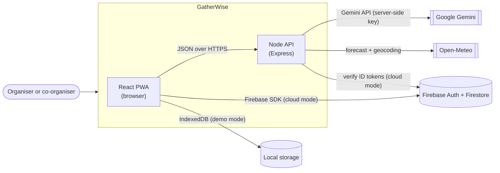
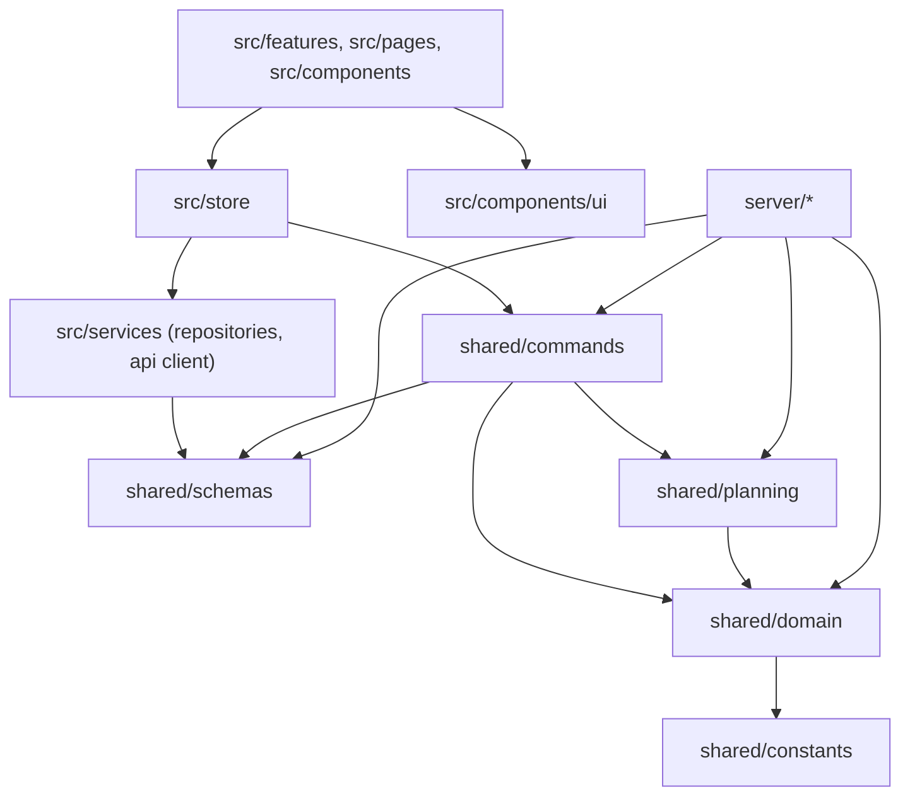
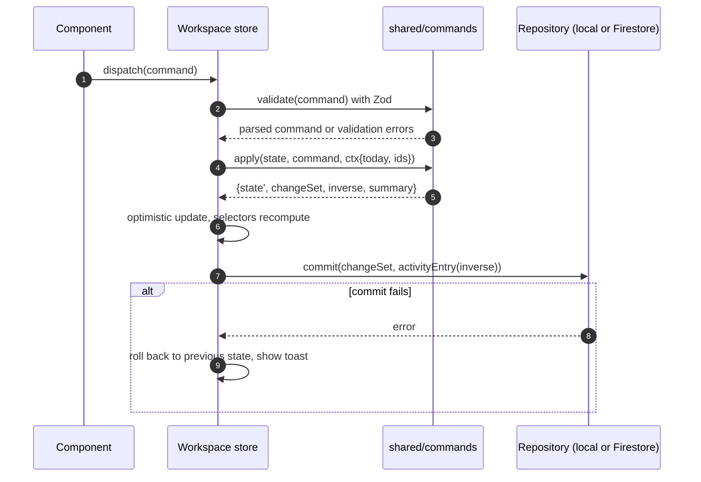

# GatherWise — Architecture

> **Status:** v1.0, 24 Oct 2026. **Audience:** the coding agent and reviewers.
> Rationale for the big decisions is in `docs/adr/`. Entities and formulas are in `DOMAIN-MODEL.md`; AI internals in `AI-DESIGN.md`; threats and rules in `SECURITY-PRIVACY.md`.

## 1. Purpose and shape

GatherWise is a **modular monolith in TypeScript**: one repository, one deployable (a Node server that also serves the React app), and a **pure, shared domain core** that both the browser and the server import. The product principle "the app calculates, the AI proposes, the human approves" is a structural property of the code, not a convention:

- Everything that must be correct (money, dates, budgets, schedules, scores) is pure functions in `shared/domain`.
- Every change to data is a validated **Command**, applied by a pure reducer, previewed by a dry run, persisted as an atomic **ChangeSet**, and undoable.
- The LLM never touches state. It calls read-only **tools** that run the same pure functions, and it returns **proposals** (lists of commands) for a human to approve.

## 2. Principles

1. **Domain first, frameworks last.** Business rules do not know React, Express, Firebase or the clock.
2. **Parse, don't trust.** Zod schemas at every boundary (UI forms, HTTP bodies, storage reads, AI output). Types are inferred from schemas.
3. **One way to change data.** `dispatch(command)`. No component writes to storage directly.
4. **Ports and adapters.** Storage, LLM, clock, id generation and weather are interfaces with swappable implementations (real, local, fake).
5. **Zero-config boot.** `npm install && npm run dev` works with no keys: local storage, rule-based assistant, sample data. Cloud and AI are additive.
6. **Explain everything.** Recommendations, risks and scores carry the inputs that produced them.
7. **Small files, clear names.** ≤ 300 lines per file (data packs and tests excepted), ≤ 40 lines per function as a guide, no god components.

## 3. System context



Only the server holds the Gemini key. The browser never calls Gemini or Open-Meteo directly.

## 4. Runtime containers

| Container | Tech | Responsibilities |
| --- | --- | --- |
| Web app | React 18+, TypeScript, Vite, Tailwind, Radix primitives, Zustand | UI, forms, local state, command dispatch, repositories (local or Firestore), PWA/offline |
| API server | Node 22, Express, Zod, helmet, express-rate-limit, `@google/genai`, optional `firebase-admin` | AI orchestration, weather proxy, health/capabilities, security middleware |
| Shared core | TypeScript only (+ Zod) | Domain functions, schemas, commands, planning engine and packs. Imported by both sides |
| Storage | IndexedDB (demo) or Firestore (cloud) | Persistence behind one repository port |

## 5. Layering and dependency rules



| From ↓ may import → | `shared/domain` | `shared/schemas` | `shared/commands` | `shared/planning` | `src/*` | `server/*` | React / DOM | Express / Node I/O | Firebase |
| --- | :-: | :-: | :-: | :-: | :-: | :-: | :-: | :-: | :-: |
| `shared/domain` | ✓ | – | ✗ | ✗ | ✗ | ✗ | ✗ | ✗ | ✗ |
| `shared/schemas` | ✓ | ✓ | ✗ | ✗ | ✗ | ✗ | ✗ | ✗ | ✗ |
| `shared/commands`, `shared/planning` | ✓ | ✓ | ✓ | ✓ | ✗ | ✗ | ✗ | ✗ | ✗ |
| `src/*` | ✓ | ✓ | ✓ | ✓ | ✓ | ✗ | ✓ | ✗ | only `src/services/repositories/firestore` |
| `server/*` | ✓ | ✓ | ✓ | ✓ | ✗ | ✓ | ✗ | ✓ | only `server/integrations/firebaseAdmin.ts` |

Enforced three ways: ESLint `no-restricted-imports` per directory override, the **architecture test** (§17), and review. A violation fails `npm run check`.

## 6. Repository layout

```text
.
├─ AGENTS.md  GEMINI.md  README.md  .env.example  .gitignore
├─ .agents/skills/                    # phase playbooks for the coding agent
├─ .github/workflows/ci.yml
├─ docs/                              # PRD, ARCHITECTURE, DOMAIN-MODEL, DESIGN-SYSTEM, AI-DESIGN, ...
├─ firebase/                          # firestore.rules, firestore.indexes.json, firebase.json
├─ scripts/verify-submission.sh
├─ public/                            # manifest, small icons (no large assets)
├─ shared/
│  ├─ domain/                         # money, time, budget, quotes, tasks, guests, readiness, risks, scenarios, runofshow, funding  (pure)
│  ├─ schemas/                        # Zod schemas: entities, commands, API DTOs, AI outputs, migrations
│  ├─ commands/                       # command definitions, reducers, previewImpact, inverse/undo
│  ├─ planning/                       # engine.ts, rules/, packs/{wedding,birthday,community}.ts, benchmarks.ts
│  └─ constants/                      # thresholds.ts, categories.ts
├─ server/
│  ├─ index.ts  app.ts                # bootstrap / createApp(deps) for tests
│  ├─ config/env.ts                   # parsed, typed environment
│  ├─ middleware/                     # requestId, security, rateLimit, auth, validate, errorHandler
│  ├─ routes/                         # health, ai, weather
│  ├─ ai/                             # llm/{port,gemini,fake}.ts, tools/, prompts.ts, sanitize.ts, assistant.ts,
│  │                                  # proposals.ts, fallback.ts, quoteScan.ts, invitations.ts, ideas.ts
│  └─ integrations/                   # openMeteo.ts, firebaseAdmin.ts
├─ src/
│  ├─ main.tsx  App.tsx
│  ├─ app/                            # router, providers, shell (sidebar, top bar, event switcher), error boundary
│  ├─ components/ui/                  # design-system primitives
│  ├─ components/charts/              # BudgetBar, ReadinessBloom, Timeline (lazy)
│  ├─ features/{events,budget,timeline,vendors,guests,assistant,ideas,scenarios,readiness,runofshow,funding,exports,settings}/
│  ├─ services/{api,repositories/{port,local,firestore},auth}/
│  ├─ store/                          # workspace store, ui store
│  ├─ demo/                           # seed scenarios, Time Travel
│  ├─ i18n/                           # en.ts (+ hi.ts when enabled)
│  └─ styles/                         # tokens.css, base.css, print.css
└─ tests/                             # architecture, security, a11y (colocated unit tests live beside source)
```

Adapt to the scaffold if the platform dictates entry points, but keep the boundaries and record any deviation in `docs/adr/`.

## 7. Core patterns

### 7.1 Command pipeline



- **Reducers are pure:** `(state, command, ctx) → {state, changeSet, inverse, summary}`. `ctx` carries `today` and an id generator.
- **ChangeSet** = `{upserts: Entity[], deletes: EntityRef[]}`; repositories persist it atomically (IndexedDB transaction / Firestore batch ≤ 500 writes).
- **Undo** = commit the stored `inverse` of the last ActivityEntry(ies); the activity log keeps the last 50.
- **`previewImpact(state, commands, today)`** runs the reducers on a copy and returns before/after for budget, readiness, task dates and risks. Proposals and the What-if Lab use it.
- **Batching:** one user action = one command = one ChangeSet = one undo step.

### 7.2 Injected time and ids

`Clock { now(): Date }` and `IdGenerator { next(): string }` are created in `src/app/providers` and passed to `ctx`. Demo **Time Travel** adds a day offset to the clock. Tests use fixed implementations. Domain code that calls `Date.now`, `new Date()` (no args) or `Math.random` fails the architecture test.

### 7.3 Errors

Expected failures are values: `Result<T, AppError>` (`ok`/`err`) in domain/services; exceptions are for bugs. API error envelope: `{ ok: false, error: { code, message, requestId } }` with a safe message (no stack traces, no upstream bodies).

| Code | HTTP | Meaning |
| --- | :-: | --- |
| `VALIDATION_ERROR` | 400 | Zod rejected the input (details list field paths, never values of secrets) |
| `UNAUTHENTICATED` / `FORBIDDEN` | 401 / 403 | Missing or invalid token / not the owner |
| `NOT_FOUND` | 404 | |
| `PAYLOAD_TOO_LARGE` | 413 | Body or upload over the route limit |
| `RATE_LIMITED` | 429 | Includes `retryAfterSeconds` |
| `AI_UNAVAILABLE` | 503 | No key, disabled, quota, timeout: the client falls back to the rule-based assistant |
| `AI_INVALID_OUTPUT` | 502 | Model output failed validation after one repair attempt |
| `UPSTREAM_ERROR` | 502 | Weather or other provider failed |
| `INTERNAL` | 500 | Logged with `requestId` |

### 7.4 Rule packs and the engine

`shared/planning/engine.ts` is generic: `generatePlan(event, pack, today) → {tasks, budgetLines, risks, vendorChecklists, outstandingDecisions, assumptions}`. Packs hold content (`TEMPLATE-PACKS.md`). Every generated item records `origin.templateId` and an `explain` string, which the UI shows under "Why this?".

## 8. Persistence

```ts
interface WorkspaceRepository {
  listEvents(): Promise<EventSummary[]>;
  load(eventId: string): Promise<Workspace>;                         // bounded reads; guests excluded
  loadGuests(eventId: string, cursor?: string, limit?: number): Promise<Page<Guest>>;
  commit(eventId: string, change: ChangeSet, activity: ActivityEntry): Promise<void>;   // atomic
  subscribe?(eventId: string, onChange: (w: Workspace) => void): Unsubscribe;          // cloud only
  deleteEvent(eventId: string): Promise<void>;                       // cascades to subcollections
  exportAll(): Promise<ExportBundle>;                                // data portability (JSON)
  clearAll(): Promise<void>;                                         // demo reset / account erase
}
```

| Adapter | Used when | Notes |
| --- | --- | --- |
| `LocalRepository` (IndexedDB) | `VITE_STORAGE_MODE=local` (default) or no Firebase config | Separate database name (`gatherwise-demo`), clearly labelled "Demo — stored only in this browser". |
| `FirestoreRepository` | `VITE_STORAGE_MODE=cloud` and signed in | Persistent local cache for offline; batched writes; reads validated through Zod on the way in; denormalised `ownerId` on every doc. Never claim it works unless it was exercised against a real project or the emulator. |
| `InMemoryRepository` | tests | |

Read cost control: events list uses a summary query; the workspace loads each subcollection once (bounded `limit`); guests are paged (100/page) and counts are derived from a lightweight aggregate; no per-component reads.

## 9. State management

One Zustand store per concern: `useWorkspaceStore` (active workspace normalised by id, `dispatch`, `undo`, status) and `useUiStore` (dialogs, filters, demo offset). Selectors are memoised and call domain functions (`computeBudgetSummary`, `displayStatus`, readiness) so the UI never duplicates logic. Components are presentational + hooks; no component holds business rules.

## 10. API

All endpoints are JSON, validated by Zod, rate limited, and return the envelope `{ok: true, data}` or the error envelope above.

| Method & path | Purpose | Auth (cloud mode) | Limits |
| --- | --- | :-: | --- |
| `GET /api/health` | Liveness + capabilities `{ai, weather, cloud}` (never secrets) | no | – |
| `POST /api/ai/chat` | Tool-grounded assistant turn → `{text, evidence[], proposals[], toolTrace[], source}` | yes | body ≤ 256 KB; ≤ 12 req/min/user-or-IP; daily cap |
| `POST /api/ai/ideas` | Personalised idea set (structured) | yes | same |
| `POST /api/ai/invitations` | Invitation drafts in a chosen language/tone | yes | same |
| `POST /api/ai/quote-scan` | Image/PDF → structured quote extraction (never stored) | yes | body ≤ 6 MB, mime allow-list + magic-byte check |
| `GET /api/weather?city=&date=` | Cached forecast summary for the event date | no | ≤ 30 req/min/IP; 3 h cache |

**Auth mode.** If Firebase Admin is configured, `Authorization: Bearer <ID token>` is required on AI routes and verified server-side; the uid comes from the verified token, never from the request body. Without Firebase (demo deployments), AI routes accept anonymous calls with stricter per-IP limits and a global daily cap so the key cannot be drained.

**Middleware order:** `requestId → helmet (CSP) → CORS (same-origin default, allow-list via env) → body size limit → rate limit → auth → Zod validation → handler → 404 → error handler`.

**Config (`server/config/env.ts`):** one Zod-parsed object; the server refuses to start on malformed values and never logs secrets. See `.env.example` for names: `PORT`, `NODE_ENV`, `LOG_LEVEL`, `GEMINI_API_KEY`, `GEMINI_MODEL`, `GEMINI_MODEL_FAST`, `AI_ENABLED`, `AI_RATE_LIMIT_PER_MIN`, `AI_DAILY_REQUEST_CAP`, `WEATHER_ENABLED`, `ALLOWED_ORIGINS`, `ALLOW_EMBEDDING`, `FIREBASE_PROJECT_ID`, `GOOGLE_APPLICATION_CREDENTIALS`, and the public `VITE_*` Firebase and storage-mode variables.

## 11. AI orchestration (summary)

Client builds a PII-minimised `AiContext` and sends it with the user's message; the server validates and sanitises it, runs a bounded tool loop against an `LlmPort` (Gemini adapter, fake adapter for tests), validates every proposal with Zod, dry-runs it with `previewImpact`, and returns text + evidence + proposals. If the model is unavailable, a rule-based assistant answers using the same tools. Full design in `AI-DESIGN.md`.

## 12. Offline and PWA

`vite-plugin-pwa` precaches the app shell and fonts; the workspace is in IndexedDB (demo) or Firestore's persistent cache (cloud), so **Day-of Mode, tasks, budget, guests and run-of-show work offline**. AI, weather and quote scanning show a clear "needs a connection" state. The service worker uses an update prompt (no silent skew), and nothing from `/api/*` is cached except `GET /api/weather`.

## 13. Performance strategy and budgets

| Budget | Target | How |
| --- | --- | --- |
| Initial JS (landing + dashboard), gzip | ≤ 180 KB | Route-level `React.lazy`, Firebase SDK imported dynamically in cloud mode only, Recharts lazy |
| Any route chunk, gzip | ≤ 100 KB | Report with `vite build` output in STATUS |
| Fonts | ≤ 90 KB total | Variable woff2, `wght` axis only, Latin + Latin-Ext (needed for ₹), `font-display: swap` |
| Domain compute | `computeBudgetSummary` over 500 lines < 10 ms | Benchmark-style test with a generous threshold |
| AI latency | progress UI immediately; p95 target < 10 s | Tool loop capped; fast model for ideas/invitations; identical requests cached 5 min |
| LCP on mid-range mobile, 4G | < 2.5 s | Measure with Lighthouse **if available**; otherwise report "not measured" |

No image assets above 100 KB; illustrations are inline SVG ≤ 3 KB.

## 14. Observability

Structured JSON logs (`ts, level, requestId, route, status, ms`, and for AI: `model, toolCalls, inputTokens, outputTokens, outcome`). Never log request bodies, event content, guest data, prompts or keys. The client has an error boundary and logs to the console only; no third-party analytics or trackers.

## 15. Build and deploy

`npm run build` → Vite client to `dist/client`, server compiled to `dist/server`; `npm start` serves both on `$PORT` with `/api/health` for platform health checks. A multi-stage `Dockerfile` (Node 22 slim, non-root user, `npm ci --omit=dev`) is added in Phase 7. The same image deploys to Cloud Run or any container host. Secrets come from the host's secret manager or env, never from the image or repo. If an embedding preview (e.g. an IDE or studio iframe) needs `frame-ancestors` relaxed, use `ALLOW_EMBEDDING=true` in that environment only.

## 16. Extending the product

*New event type:* add `packs/<type>.ts` (presets, tasks, budget profile, risk rules, checklists, ideas), extend the `EventType` union and schema, add wizard step config, add pack tests. No engine, store or UI changes beyond labels.
*New command:* add schema, reducer, inverse, preview support, AI allow-list decision, tests.
*New AI capability:* add a tool (pure, schema-validated, read-only) and, if it can change data, a proposal builder; never a direct write.

## 17. Architecture fitness tests (`tests/architecture.test.ts`)

1. `shared/domain` and `shared/schemas` import nothing outside `shared/{domain,schemas,constants}` and contain no `Date.now`, `new Date()` without arguments, `Math.random`, `fetch`, `process.env` or `window`.
2. `src` never imports from `server`; `server` never imports from `src`.
3. Firebase packages are imported only in the two adapter files.
4. No `dangerouslySetInnerHTML` and no `eval`/`new Function` anywhere.
5. No `any` and no `@ts-ignore` / `@ts-expect-error` without a justification comment.
6. No source file over 400 lines (data packs, generated code and tests excluded).
7. Every Express route registers a Zod `validate(...)` middleware (static scan).
8. After `vite build`, `dist/client` contains no `AIza`-pattern string and no `GEMINI_API_KEY` text.

## 18. ADR index

| ADR | Decision |
| --- | --- |
| 0001 | TypeScript end-to-end with a shared pure core |
| 0002 | Money as integer minor units |
| 0003 | Commands, change sets, preview and undo; injected clock |
| 0004 | Tool-grounded LLM: the model never does arithmetic or writes state |
| 0005 | Storage ports: local-first demo, optional Firestore |
| 0006 | Planning content as data (template packs) |
| 0007 | PII-minimised, client-supplied AI context |
| 0008 | No fabricated vendors or prices; heuristics carry provenance |
| 0009 | Multi-function events via SubEvent |
| 0010 | GST-aware quotation normalisation with user-supplied rates |
