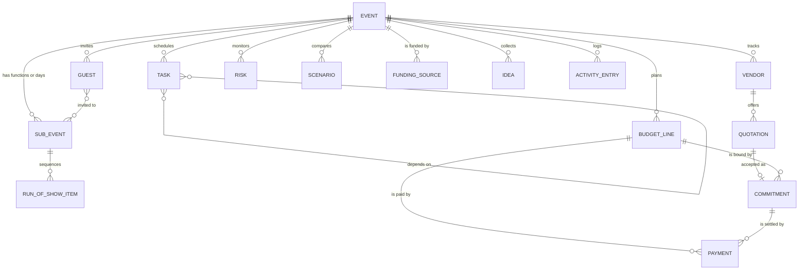

# GatherWise — Domain Model & Business Rules

> **Audience:** the coding agent and reviewers. **Status:** v1.0, 24 Oct 2026.
> This is the single source of truth for entities, invariants and formulas. If code and this document disagree, fix one of them in the same commit.
> Worked examples marked **✅ kernel** are exercised by tests in `shared/domain/**` and were verified by running them.

## 1. Conventions

| Topic | Rule |
| --- | --- |
| IDs | Strings from an injected `IdGenerator` (`crypto.randomUUID()` in the app, deterministic in tests). Never derive meaning from an id. |
| Timestamps | ISO-8601 UTC strings (`createdAt`, `updatedAt`). Firestore `Timestamp`s are converted at the repository edge only. |
| Calendar dates | `IsoDate` = `YYYY-MM-DD` in the **event's** time zone (`Event.timezone`, default `Asia/Kolkata`). Arithmetic is UTC-epoch-day based so DST can never shift a deadline. |
| Clock times | `IsoTime` = `HH:mm` (24 h) in the event time zone. UI shows 12-hour times. |
| "Today" | Always a function argument (`today: IsoDate`). Domain code never reads the system clock or `Math.random()`. |
| Money | `Minor` = integer minor units (paise for INR). One currency per event (`Event.currency`). Percentages are plain numbers with ≤ 2 decimals (18, 2.5). |
| Derived data | Statuses, summaries, scores and risk instances are **computed, never persisted** (exception: user decisions on risks, see §5.9). |
| Versioning | Every persisted document carries `schemaVersion: 1`. Migrations live in `shared/schemas/migrations.ts`. |
| Deletion | Hard delete, always through a command whose inverse is stored in the activity log (so Undo works). |
| Untrusted text | Any free text (notes, names, culture notes, vendor notes, scanned quote text) is data. Length-limit it in the schema and never let it act as an instruction (see `AI-DESIGN.md`). |

## 2. Entities

`✱` = required. Types are TypeScript-like; implement them as **Zod schemas first** and infer the types (`shared/schemas/`).

### 2.1 Event (aggregate root)

| Field | Type | Notes |
| --- | --- | --- |
| `id`✱, `schemaVersion`✱, `ownerId`✱ | string, 1, string | `ownerId` is `'demo'` in local mode, the Firebase uid in cloud mode. |
| `type`✱ | `'wedding' \| 'birthday' \| 'community'` | Drives the template pack. `subtype?` is free-form (`college_fest`, `festival`, `fundraiser`, `neighbourhood`, `engagement`, `anniversary`…). |
| `name`✱ (≤ 80) | string | |
| `date`✱ | IsoDate | First day of the event. Multi-day events use `SubEvent`s. |
| `timezone`✱, `currency`✱ | IANA string, CurrencyCode | Defaults `Asia/Kolkata`, `INR`. |
| `city`✱ (≤ 60), `cityTier` | string, `'tier1' \| 'tier2' \| 'tier3' \| 'other' \| 'unspecified'` | Tier is user-chosen; used only to pick benchmark bands (see `BENCHMARKS.md`). |
| `venueStatus`✱, `setting`✱ | `'not_started' \| 'shortlisting' \| 'booked' \| 'home' \| 'open_ground'`; `'indoor' \| 'outdoor' \| 'mixed'` | `setting` drives weather and rain-plan rules. |
| `budgetTarget`✱, `contingencyPct`✱ | Minor, number 0–50 | Default contingency 7 (editable heuristic). |
| `fundingMode`✱ | `'self_funded' \| 'sponsored'` | `sponsored` enables the Funding tracker. |
| `attendanceModel`✱ | `'invite_list' \| 'open_footfall'` | Weddings/birthdays: invite list. Fests/public events: footfall estimate (`footfall: {low, likely, high}`). |
| `audience` | `'local' \| 'destination' \| 'house_party' \| 'public'` | Picks attendance heuristics. |
| `attendanceAssumptions` | `{pMaybe, pPending, bufferPct}` | Defaults from `DEFAULT_ATTENDANCE`; recalibrated by `calibratePending`. |
| `style` | `{theme?, formality, vibe: string[]}` | `formality`: `casual \| semi_formal \| formal`. |
| `priorities`✱ | ordered array (max 3) of `food \| photography \| entertainment \| decor \| venue \| comfort \| savings \| sustainability \| accessibility` | Used by scenarios, recommendations and AI. |
| `dietary`, `accessibilityNeeds` | tag arrays | See §2.9 for tag lists. |
| `culturalNotes` (≤ 500) | string | Untrusted free text. |
| `sideLabels` | `{a: string, b: string}` | Weddings: default `Side A` / `Side B`; the wizard lets users name them. Never assume genders. |
| `presetId?`, `honoreeAge?` | string, number | Wedding function preset; birthday age. Do not store a child's surname. |

### 2.2 SubEvent (function / day / session)

`id`, `eventId`, `name`✱, `kind` (`ceremony \| reception \| pre_event \| day \| session \| other`), `date`✱, `startTime?`, `endTime?`, `venueLabel?`, `dressCode?`, `headcountMode` (`from_guests \| manual`), `manualHeadcount?`, `order`, `notes?`.
A single-day event has exactly one implicit SubEvent. UI labels come from the template pack ("Function", "Day", "Session").

### 2.3 BudgetLine, Commitment, Payment

| BudgetLine | |
| --- | --- |
| `id`, `eventId`, `category`✱ (id from pack), `label`✱ | |
| `estimate`✱ (Minor, "likely"), `estimateLow?`, `estimateHigh?` | |
| `basis`✱ | `template \| user \| quote \| actual` — shown as a badge so illustrative numbers are never mistaken for quotes. |
| `scalesWithHeadcount`✱ | boolean — drives the What-if Lab. |
| `subEventId?`, `locked` | `locked` lines are skipped by auto-reallocation proposals. |

| Commitment (money you are bound to pay) | |
| --- | --- |
| `id`, `eventId`, `budgetLineId`✱, `vendorId?`, `quotationId?`, `label`✱ | |
| `amount`✱ | Minor, **tax-inclusive**. Snapshot taken when a quote is accepted. |
| `headcountAtAcceptance?` | number — enables commitment-drift warnings (§5.5). |
| `status`✱ | `active \| cancelled` |

| Payment | |
| --- | --- |
| `id`, `eventId`, `budgetLineId`✱, `commitmentId?`, `vendorId?` | |
| `kind`✱ | `deposit \| installment \| final \| expense \| refund` |
| `amount`✱ (positive Minor), `status`✱ (`planned \| paid \| cancelled`) | |
| `mode`✱ | `upi \| cash \| bank_transfer \| cheque \| card \| other` — cash is first-class because it is common and must be tracked. |
| `dueDate?`, `paidDate?`, `reference?` (≤ 12) | `reference` holds only the last digits of a UPI/cheque reference. **Never** store account or card numbers; the UI warns about this. |
| `source` | `manual \| ai_assisted` |

### 2.4 Vendor and Quotation

Vendor: `id`, `eventId`, `name`✱, `category`✱, `status`✱ (`to_research \| shortlisted \| contacted \| quote_received \| booked \| completed \| cancelled`), `contact {phone?, whatsapp?, email?}`, `city?`, `notes`, `userRating?` (0–5, the organiser's own). **No** verified/recommended flags, ratings imported from anywhere, or invented listings, ever.

Quotation: `id`, `eventId`, `vendorId`✱, `budgetLineId?`, `title`, `pricing`✱ (`fixed \| per_head \| per_unit`, see kernel), `taxMode`✱ (`inclusive \| exclusive \| unknown`), `gstPct?`, `serviceChargePct?`, `inclusions` (key → boolean), `exclusionsNote?`, `depositPct?`, `paymentSchedule?` (`[{label, pct, dueDate?}]`, must total 100), `validUntil?`, `freeCancellationDaysBefore?`, `cancellationNote?`, `status` (`received \| shortlisted \| accepted \| rejected`; *expired* is derived from `validUntil`), `source` (`manual \| scanner`), `notes`.

### 2.5 Task

`id`, `eventId`, `subEventId?`, `title`✱, `description?`, `category`✱, `priority`✱ (`critical \| high \| medium \| low`), `dueDate`✱, `dueDateLocked` (user pinned the date), `status`✱ (`todo \| in_progress \| done \| skipped`), `assignee?` (free text ≤ 60), `dependsOn: string[]`, `notes?`, `effort` (`S \| M \| L`, default from pack), `origin` (`{kind: 'template' \| 'user' \| 'ai', templateId?, proposalId?}`), `anchor` (`{to: 'event' \| 'subEvent', subEventId?, leadDays, minLeadDays}` — so a date change can re-flow unlocked tasks).
Derived: `displayStatus`, `blocked`, `slackDays` (§5.7).

### 2.6 Guest (one invitation unit: a person or a household)

`id`, `eventId`, `name`✱ (e.g. "Mishra family"), `group?` (free tag ≤ 40), `side?` (`a \| b \| shared`), `partySize`✱ (≥ 1, includes children), `childrenUnder5`, `children5to12`, `contact {phone?, email?}`, `inviteSent` (`not_sent \| sent`), `invitations: Record<subEventId, {invited: boolean, status: 'pending' \| 'attending' \| 'declined' \| 'tentative', confirmedParty?: number}>`, `dietary: DietTag[]`, `accessibility: AccessTag[]`, `accessibilityNote?` (≤ 200, **sensitive**), `table?`, `notes?`.
Plate equivalents for catering: `partySize − childrenUnder5 − 0.5 × children5to12` (ratios are editable assumptions; confirm with the caterer).

### 2.7 Risk, Scenario, FundingSource, RunOfShowItem, Idea, ActivityEntry

| Entity | Fields |
| --- | --- |
| Risk | `id`, `eventId`, `dedupeKey`✱, `ruleId?`, `title`, `detail`, `severity` (`low \| medium \| high \| critical`), `status` (`open \| mitigating \| resolved \| accepted`), `mitigation`, `source` (`rule \| user \| ai`), `refs`, `decisionNote?`, `decidedAtSeverity?` |
| Scenario | `id`, `eventId`, `name`, `changes` (§5.10), `createdAt` — results are always recomputed |
| FundingSource | `id`, `eventId`, `kind` (`own_funds \| family \| sponsorship \| tickets \| donations \| grant \| other`), `name`, `amount` (expected Minor), `received` (Minor), `status` (`prospect \| pitched \| verbal \| confirmed \| received \| declined`), `inKind`, `dueDate?`, `deliverables [{id,label,done}]` |
| RunOfShowItem | `id`, `eventId`, `subEventId`, `startTime`, `durationMin`, `title`, `owner?`, `vendorId?`, `location?`, `bufferAfterMin`, `fixedTime`, `status` (`pending \| in_progress \| done \| skipped`), `notes?` |
| Idea | `id`, `eventId`, `kind` (`theme \| menu \| decor \| activity \| entertainment \| favour \| sustainability`), `title`, `summary`, `whyItFits: string[]`, `budgetTier` (1–3), `effort` (1–3), `tags`, `source` (`library \| ai`), `pinned` |
| ActivityEntry | `id`, `eventId`, `at`, `actor` (`user \| assistant_proposal \| system`), `summary`, `commandTypes[]`, `inverse` (ChangeSet or null), `undone` |

### 2.8 Proposal (session-scoped, not persisted)

`id`, `source` (`assistant \| rules \| scanner`), `title`, `rationale`, `commands: Command[]`, `evidence: [{tool, summary}]`, `assumptions: string[]`, `impact` (deterministic dry-run result, §6), `status` (`pending \| approved \| partially_approved \| rejected`). Approved proposals leave an ActivityEntry; rejected ones are discarded.

### 2.9 Tag lists

`DietTag`: `veg`, `non_veg`, `eggetarian`, `jain`, `vegan`, `halal`, `no_onion_garlic`, `gluten_free`, `lactose_free`, `nut_allergy`, `other`.
`AccessTag`: `wheelchair`, `limited_mobility`, `elder_seating`, `hearing`, `vision`, `neurodiverse_quiet_space`, `child_care`, `other`.
Allergy/accessibility data is sensitive: excluded from AI context by default, behind a confirm on export.

## 3. Relationships



## 4. Invariants (enforced by schemas, reducers and tests)

1. **INV-01** All money fields are safe integers; no float ever crosses a module boundary.
2. **INV-02** Every `budgetLineId`, `vendorId`, `subEventId`, `commitmentId` points at a record of the same event.
3. **INV-03** `Task.dependsOn` is acyclic; a dependency on a deleted task is removed in the same ChangeSet.
4. **INV-04** A deposit or instalment is a `Payment`; it never creates or increases a `Commitment`.
5. **INV-05** `paymentSchedule` percentages sum to exactly 100 (use `allocateByWeights` to split amounts).
6. **INV-06** `Guest.partySize ≥ 1`; `childrenUnder5 + children5to12 ≤ partySize`.
7. **INV-07** `confirmedParty ≤ partySize` and only exists when status is `attending`.
8. **INV-08** `Event.date` in the past is allowed only in *reconciliation mode* (no task generation; post-event variance view). The wizard offers "correct the date" or "reconcile a past event".
9. **INV-09** A quote cannot be accepted while expired unless the user explicitly overrides; the override is logged.
10. **INV-10** Derived values are never written back to documents.

## 5. Business rules and formulas

### 5.1 Budget identity ✅ kernel (`budget/budget.ts`)

```text
committed(line)   = Σ active commitments                                  (tax-inclusive)
paid(line)        = Σ paid payments − Σ paid refunds
outstanding(line) = commitment ? max(0, committed − paid) : 0
projected(line)   = commitment ? max(committed, paid) : max(estimate, paid)
projected(total)  = Σ projected(line)
reserve           = target × contingencyPct        spendable = target − reserve
status            = projected > target ? 'over' : projected > spendable ? 'tight' : 'healthy'
contingencyUsed   = min(reserve, max(0, projected − spendable))
```

Deposits and instalments reduce `outstanding` but never raise `committed`, so nothing is counted twice. Refunds reduce `paid`. Cancelled commitments are ignored, but money already paid against them stays in `paid` and raises an issue (`paid_against_cancelled_commitment`). Payments or commitments pointing at unknown lines are reported as issues, never silently dropped.

### 5.2 Allocation ✅ kernel (`money/allocate.ts`)

Largest-remainder split: parts always sum exactly to the total. Wedding example for a ₹18,00,000 target, 7 % contingency (profile weights from `TEMPLATE-PACKS.md`):

| Line | Weight | Allocation |
| --- | ---: | ---: |
| Contingency reserve (7 %) | — | ₹1,26,000 |
| Venue | 22 % | ₹3,68,280 |
| Catering | 35 % | ₹5,85,900 |
| Decor & flowers | 11 % | ₹1,84,140 |
| Photo & video | 8 % | ₹1,33,920 |
| Music & entertainment | 6 % | ₹1,00,440 |
| Attire & beauty | 6 % | ₹1,00,440 |
| Invitations | 2 % | ₹33,480 |
| Transport | 3 % | ₹50,220 |
| Accommodation | 3 % | ₹50,220 |
| Rituals & misc | 2 % | ₹33,480 |
| Gifts & favours | 2 % | ₹33,480 |
| **Total** | | **₹18,00,000** (exact) |

These are *starting estimates* (`basis: 'template'`), shown with an "illustrative" badge until the organiser replaces them with quotes.

### 5.3 Per-guest sanity check

`perGuest = projected(total) / planned headcount`. Compare with the band for the event type and city tier in `BENCHMARKS.md`. Outside the band → an informational nudge ("this works out to ₹X per guest; typical metro mid-range figures reported in published guides are ₹A–₹B"), never an error. If no band exists for the tier, show the user's own figure only.

### 5.4 Quotation normalisation ✅ kernel (`quotes/quotes.ts`)

```text
base      = fixed amount | unit × headcount | unit × quantity
subtotal  = base + serviceCharge%·base
payable   = exclusive ? subtotal × (1 + gst%)
          : inclusive ? subtotal
          : unknown   ? low = subtotal, likely = high = subtotal × (1 + defaultGst%)   (cautious)
```

GST rates are **inputs**, never constants asserted by the app. Missing rates fall back to an editable planning default and raise `gst_rate_missing`. Rounding is half away from zero on whole paise.

Worked example at 300 guests: caterer A "₹1,400 per plate + 18 % GST" → **₹4,95,600**; caterer B "₹1,550 per plate, all-inclusive" → **₹4,65,000**. The cheaper headline costs ₹30,600 more. ✅ kernel

Comparison is transparent weighted scoring (default weights price 40, inclusions 25, terms 15, reliability 10, fit 10). Criteria without data are dropped and the remaining weights re-normalised. Expired quotes are listed last and never ranked. A ranking needs ≥ 2 eligible quotes (`comparable`).

### 5.5 Commitment drift

For a per-head commitment accepted at `headcountAtAcceptance = N`, show "agreed at N guests; at the current plan of M guests this would be ≈ ₹X" using `normalizeQuote` with headcount `M`. Raise a risk when `|M − N| / N > 5 %`. Fixed-price commitments never drift.

### 5.6 Headcount ✅ kernel (`guests/headcount.ts`)

```text
uncertain = maybe × pMaybe + pending × pPending
likely    = round(yes + uncertain)           low = round(yes + 0.5 × uncertain)     high = yes + maybe + pending
catering  = ceil(likely × (1 + bufferPct))   (defaults pMaybe 0.5, pPending 0.8, bufferPct 0.05)
```

Counts are party-size weighted. Example (yes 100, maybe 20, pending 50, declined 30) → low 125, likely 150, high 170, catering **158**. ✅ kernel
**Calibration:** after a function, `calibratePending(assumptions, planned, actual)` scales `pPending` by `actual / planned`, bounded to 0.75–1.25 and capped at 1.0, so the next function's estimate learns from the organiser's own crowd. Published attrition figures are mostly Western; treat all defaults as starting points (see `BENCHMARKS.md`).
Open-footfall events use `footfall.low/likely/high` directly.

### 5.7 Task scheduling ✅ kernel (`tasks/schedule.ts`)

For each template with `leadDays` L and `minLeadDays` m, and `R` = days from today to the event, `longest` = largest L in the plan:

1. **L ≤ R** → due = event − L (`ok`).
2. **m ≤ R < L** → compressed: `offset = min(round((longest − L) × R / longest), R − m)` days after today (`compressed`).
3. **R < m** → due today (`infeasible`, raises a risk).
4. Dependencies are enforced last: a task is never earlier than its prerequisites (`dependencyAdjusted`); if that pushes it past `event − m`, it becomes `infeasible` with `dependencyConflict`.

Worked example (assuming today is 21 Oct 2026, the fixture date used in the kernel tests; venue 270/60 days, caterer 180/45 after venue, photographer 150/30, invitations 60/21, final headcount 7/3 after caterer): ✅ kernel

| Task | Event in 300 days | Event in 90 days | Event in 45 days |
| --- | --- | --- | --- |
| Book venue | 20 Nov 2026 ok | 21 Oct 2026 compressed | 21 Oct 2026 **infeasible** |
| Book caterer | 18 Feb 2027 ok | 20 Nov 2026 compressed | 21 Oct 2026 compressed |
| Book photographer | 20 Mar 2027 ok | 30 Nov 2026 compressed | 5 Nov 2026 compressed |
| Send invitations | 18 Jun 2027 ok | 20 Nov 2026 ok | 14 Nov 2026 compressed |
| Final headcount | 10 Aug 2027 ok | 12 Jan 2027 ok | 28 Nov 2026 ok |

`displayStatus`: `completed` (done) · `skipped` · `overdue` (due < today) · `due_soon` (≤ 3 days, configurable) · `upcoming`. `blocked` = any prerequisite neither done nor skipped.
`slackDays(task) = min(due of dependents, or event date if none) − due(task)`; negative slack means a dependency violation; zero-slack incomplete tasks form the critical path shown in the timeline.
**Event-date change:** unlocked template-anchored tasks are re-planned with the same algorithm and offered as a *proposal* (diff of old → new dates); locked or user-created tasks never move; infeasible results are surfaced before approval.

### 5.8 Readiness score (explainable, 0–100)

Two numbers, so a brand-new event is not falsely "90 % ready":

- **Readiness** — absolute completeness of the plan today.
- **Expected** — what Readiness would be if the plan were on schedule today (tasks due by today done, essentials whose "book by" date has passed secured, etc.).
- **Pace** = Readiness − Expected → `≥ −5` *On track*, `−5…−15` *Slightly behind*, `< −15` *Behind*.

| Dimension | Pts | Readiness (absolute) | Expected |
| --- | ---: | --- | --- |
| Tasks | 35 | Σ weight(done) ÷ Σ weight(all not skipped); weights critical 3, high 2, medium 1, low 0.5 | same, counting tasks due ≤ today as done |
| Essentials | 25 | Share of essential categories secured (commitment or booked vendor); venue and catering count ×2; `essentials` and `bookByDays` from the pack | secured if `bookByDays` has passed |
| Money | 20 | `committed ÷ projected` × health factor (healthy 1, tight 0.85, over 0.5) − 0.1 per overdue payment (floor 0) | expected coverage = clamp(1 − daysToEvent/180, 0, 0.9) × factor |
| Guests | 10 | Invite list: 50 % invitations sent + 50 % RSVP replies ÷ invited. Open footfall: weighted completion of publicity, crowd and access tasks | invitations expected by event − 45 days; replies expected = clamp(1 − daysToEvent/60, 0, 0.9) |
| Safety net | 10 | 1 − (0.4 × open critical + 0.2 × open high + 0.05 × open medium risks without mitigation), floor 0 | 10 |

`score = round(Σ points)`. The UI shows the five dimensions as the **Readiness Bloom** (five petals), the Expected marker, the Pace badge, and the **three next best actions**: for each candidate fix (finish task, secure essential, record quotes, resolve risk) compute `Δpoints ÷ effort(S=1, M=2, L=4)`, multiplied by 1.5 if overdue or 1.25 if due within 7 days; show the top three with their point gain. A score never implies the event will succeed (copy rule).

### 5.9 Risk detection

Rules are data (`shared/planning/rules/risks/*.ts`): `{id, appliesTo, evaluate(ctx) → Finding[]}`. The catalogue is in `TEMPLATE-PACKS.md` §5. A finding has a stable `dedupeKey` (e.g. `outdoor.no-rain-plan`). Risk instances are recomputed on every change and merged with stored user decisions:

- `resolved`: hidden while the condition is false; reappears (open) if the condition returns.
- `accepted`: hidden with the user's note until severity **increases** over `decidedAtSeverity`.
- `mitigating`: shown with the user's note.

### 5.10 Scenarios (What-if Lab)

Inputs (`Scenario.changes`) are explicit, user-entered numbers — never market data:

```ts
{ headcount?: number,                       // new planned headcount for the main function
  lineAdjustments?: [{ budgetLineId, mode: 'set' | 'percent', value }],
  perHeadOverrides?: [{ budgetLineId, unitPrice }],   // e.g. a different catering style's plate price
  disabledLines?: string[] }                // optional lines dropped (e.g. live music)
```

1. Lines with `scalesWithHeadcount` and no override scale by `new ÷ old` headcount (rounded); per-head commitments scale via `normalizeQuote`; fixed ones do not.
2. Adjustments and overrides apply next; disabled lines contribute 0.
3. Re-run `computeBudgetSummary` on the modified copy.
4. Report deltas: projected, remaining to target, contingency remaining, status change, per-guest cost.
5. Flag **priority conflicts** (a line mapped to a top-3 priority reduced by > 10 %) and **breaches** (status becomes `over`).
Default numeric inputs are blank or 0 %. The lab shows consequences; it does not pretend to know prices.

### 5.11 Run-of-show delay cascade

`applyDelay(items, itemId, delayMin)` walks the items of the same function in start order. The delayed item moves by `delayMin`. For each following item, the delay carried forward is `max(0, carried − bufferAfterMin of the previous item)`. An item with `fixedTime` does not move: propagation stops there and a conflict is reported ("Pheras are fixed; you are 12 min late"). Overlaps for the same `owner` or `location` are detected after every change.

### 5.12 Funding coverage (sponsored events)

`confirmed = Σ amount where status ∈ {confirmed, received}` (cash only; in-kind shown separately). `expected = confirmed + Σ amount × stageWeight` with editable stage weights (defaults prospect 0.1, pitched 0.25, verbal 0.6; **heuristics**, labelled as such). `coverage = confirmed ÷ projected spend`, `expectedCoverage = expected ÷ projected spend`. A single source above 50 % of confirmed funds raises a concentration risk.

### 5.13 Weather rules

Open-Meteo daily values for the event date (only within the provider's forecast window). Outdoor or mixed events: rain risk **high** if `precipitationProbabilityMax ≥ 50 %` or `precipitationSum ≥ 5 mm`, **medium** if ≥ 30 %; heat risk when `temperatureMax ≥ 38 °C`; wind risk for tents when `windMax ≥ 40 km/h`. Thresholds live in `shared/constants/thresholds.ts` and are labelled heuristics. Outside the forecast window show a seasonal note and the date the forecast becomes available.

### 5.14 Time

`Clock` port with `now(): Date`. `today = todayInZone(clock.now(), event.timezone)`. In demo mode a `demoOffsetDays` value (Time Travel) is added so reviewers can watch statuses, scores and risks change as time passes.

## 6. Commands, change sets and the AI allow-list

Every mutation is a **Command** (`{type, payload}`) validated with Zod and applied by a pure reducer returning `{state, changeSet, inverse, summary}`. A `ChangeSet` is `{upserts: Entity[], deletes: EntityRef[]}` and is what repositories persist atomically. `previewImpact(state, commands, today)` dry-runs commands on a copy and returns before/after budget, readiness, task dates and risks. Undo applies the stored inverse.

| Command | AI may propose | Notes |
| --- | :---: | --- |
| `CreateEvent`, `UpdateEvent`, `DeleteEvent`, `SetBudgetTarget` | ✗ | The organiser owns these. |
| `AddSubEvent`, `UpdateSubEvent`, `RemoveSubEvent` | ✗ | |
| `AddTasks`, `RescheduleTasks` | ✓ | Never touches `dueDateLocked` tasks. |
| `UpdateTask`, `CompleteTask`, `RemoveTask` | ✗ | |
| `UpsertBudgetLines`, `ReallocateBudget` | ✓ | Estimates only; never `locked` lines, never actuals. |
| `AddVendor`, `AddQuotation` | ✓ (scanner / quick-add, human-edited first) | |
| `AcceptQuotation`, `UpdateVendor` | ✗ | Acceptance creates a commitment; humans only. |
| `RecordPayment` | ✓ (quick-add, explicit confirm, flagged `ai_assisted`) | |
| `AddGuests`, `SetRsvp` | ✗ | Guest data stays with the organiser. |
| `AddRisks` | ✓ | |
| `ResolveRisk`, `SaveScenario` | ✗ | |
| `PinIdea` | ✓ | |
| `AddRunOfShowItems` | ✓ | |
| `ApplyDelay`, funding commands | ✗ | |
| Any `Delete*` / `Remove*` | ✗ | |

## 7. Firestore mapping (cloud mode)

`users/{uid}` and `events/{eventId}` with subcollections `subEvents`, `budgetLines`, `commitments`, `payments`, `vendors`, `quotations`, `tasks`, `guests`, `risks`, `scenarios`, `funding`, `runOfShow`, `ideas`, `activity`. Every document carries a denormalised `ownerId` so rules are a single comparison; creates additionally verify the parent event's owner. Reads are bounded (`limit`), guests are paged, and summaries are computed client-side from loaded data. See `SECURITY-PRIVACY.md` for the rules and `ARCHITECTURE.md` §8 for adapters.
